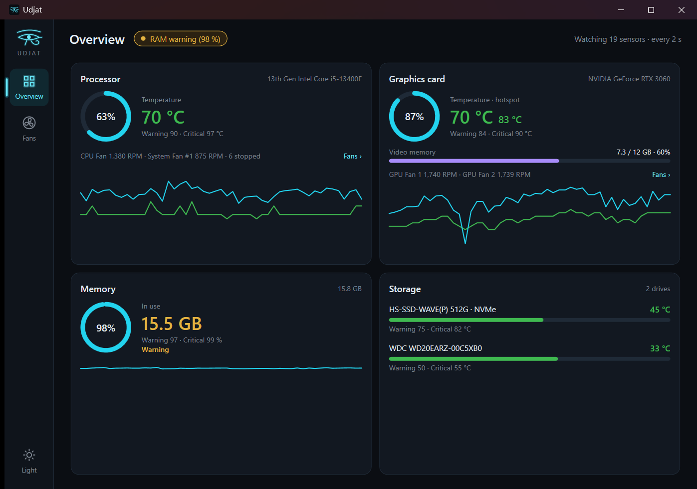
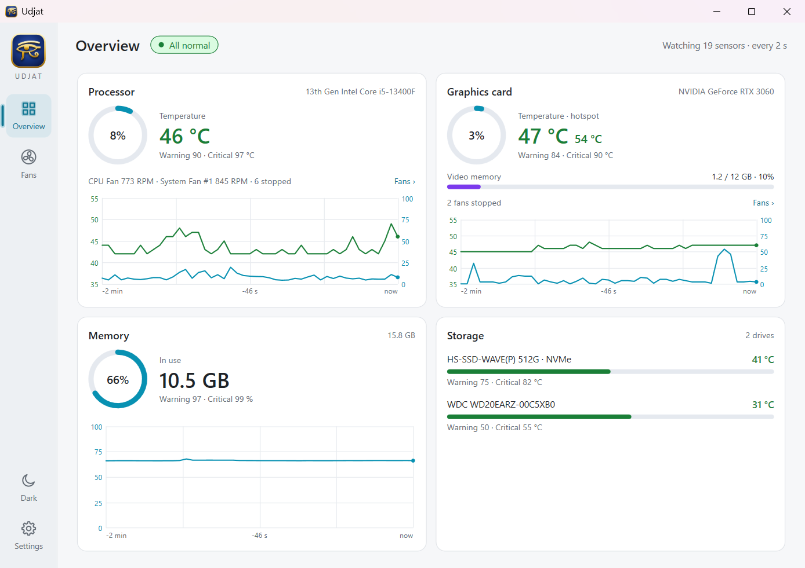
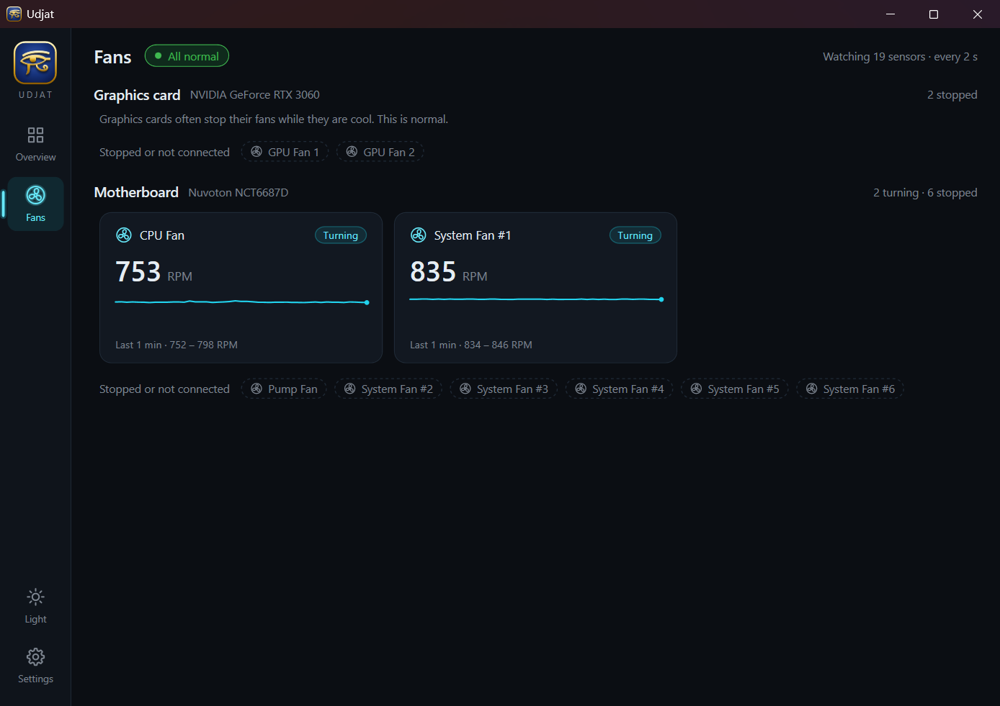
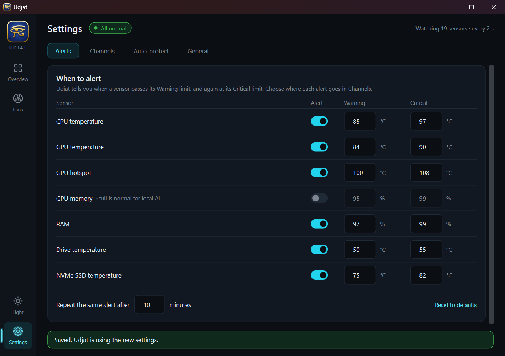
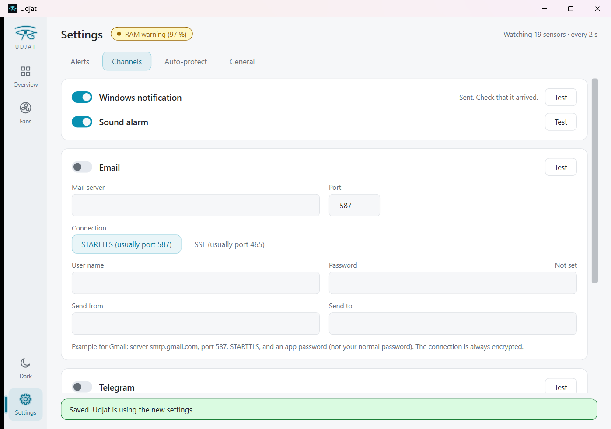
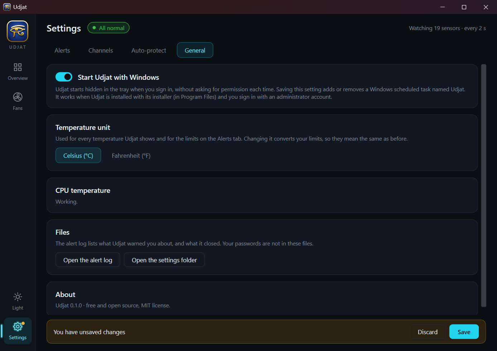

# Udjat

> A lightweight hardware watchdog for people running local AI models.

Running LLMs and image models locally can keep your CPU and GPU at full load for
hours. Udjat watches the few sensors that matter and alerts you before your
hardware gets into trouble.

**Status:** early development. The app runs: a tray icon, a window with an Overview, a Fans page and a
Settings page (dark and light), Windows notification, sound, email and Telegram alerts, and auto-protect.
The installer is on the [Releases page](https://github.com/Salah-Elsayed404/Udjat/releases); you can also build it yourself (see below).

## The story
I started running local AI models heavily, and my PC often kept working while I was away from it. What worried me was not the
model but my hardware: what if the CPU, the graphics card or the drives ran far above their normal temperatures while nobody was
watching?

I looked for something that would watch the temperatures and tell me when things got out of hand. The tools that could do it
needed a technical person, or several programs glued together, before they did the job. So I decided to build it myself.

The first version took about four hours of vibe coding with Claude Code. It watched the temperatures and the resource use. At a warning level it
gave me a notification; at a critical level it sent me an email. If the PC stayed critical for a time I chose, it closed the
task that was eating the resources, by itself. That part is something you switch on yourself, and it only closes programs from a
list you choose.

That small tool worked, so I kept going, still with Claude Code. The whole program, from that first version to the app in this
repository, was built this way, step by step: a tray icon, a dashboard, alerts by Windows notification, sound, email and Telegram,
an installer, and written decisions, tests and a security review along the way. My friend Ramy Hassan helped me test the security
parts, including how sensitive information such as the email password and the Telegram token is stored and protected.

Udjat is the ancient Egyptian name of the Eye of Horus, a symbol of protection and watchfulness. That is the whole idea: something
that keeps watch over my computer while I am not there.

## Why Udjat
Most hardware monitors show hundreds of sensors. Udjat shows only the essentials
and focuses on one job: alert you when something gets too hot.

## Features
- Monitors CPU and GPU temperature, GPU hotspot, VRAM usage, fan speeds, RAM and drive temperature (NVIDIA, AMD, Intel GPUs), and shows CPU and GPU load
- Two limits per sensor, Warning and Critical, and you choose where each alert goes
- Alerts by email, Telegram, Windows notification and local sound alarm, each with a Test button
- Optional auto-protect (off by default): closes only the programs on your list (e.g. Ollama), and only your own, if the hardware stays critically hot
- Per-sensor cooldown so you are not flooded with alerts
- One window with a side menu: an Overview with a panel per part of the PC and a small chart in each, a Fans page, and Settings
- Dark and light themes, and a tray icon (the Eye of Horus) that changes colour with the status; the program icon is the eye in gold on lapis blue
- Charts on a grid with the numbers and the time on them, and a Celsius or Fahrenheit setting
- Passwords and the Telegram token go to Windows Credential Manager, never to a file
- Small, readable codebase

## Screenshots

| Overview (dark) | Overview (light) |
|---|---|
|  |  |

| Fans | Settings: when to alert |
|---|---|
|  |  |

| Settings: channels (light theme) | Settings: general, with the temperature unit |
|---|---|
|  |  |

## Platform
Windows (v1). So far Udjat has been tried on two PCs with NVIDIA graphics cards (one of them has a GeForce RTX 3060 and an Intel Core i5-13400F).
AMD and Intel graphics cards are read through the same sensor library ([LibreHardwareMonitor](https://github.com/LibreHardwareMonitor/LibreHardwareMonitor))
but have not been tried yet; reports are welcome.

## CPU temperature note
Reading CPU temperature needs the [PawnIO](https://pawnio.eu) driver, which is installed separately. Udjat works without it (GPU, drives, RAM and fans); the CPU sensor simply stays disabled until PawnIO is installed.

## Installation
Download `Udjat-Setup-<version>.exe` from the [GitHub Releases page](https://github.com/Salah-Elsayed404/Udjat/releases); the release notes carry its SHA-256. It installs Udjat into Program Files (there is no folder choice, on purpose: see Security) with everything it needs (you do not install .NET), adds a Start menu shortcut, and removes itself cleanly: uninstalling closes Udjat, deletes its "start with Windows" task, and asks whether to also delete your settings and saved passwords.

The installer is not code-signed yet, so Windows SmartScreen may warn before it runs.

### Building the installer yourself
You need the [.NET 10 SDK](https://dotnet.microsoft.com/download) and [Inno Setup 6](https://jrsoftware.org/isinfo.php). Then:

```
powershell -File tools\build-installer.ps1
```

It publishes the app (self-contained, about 170 MB before compression) and writes `artifacts\Udjat-Setup-<version>.exe` (about 53 MB). The version is the `<Version>` in `src/Udjat/Udjat.csproj`. The program icon is made by `tools/make-icon.ps1` from the same Eye of Horus drawing the window uses.

## Usage
Udjat always runs with administrator rights, because reading hardware sensors needs them. Windows asks once when you start it.

- **Overview**: how each part of the PC is doing now. The colour and the words say Normal, Warning or Critical.
- **Fans**: every fan, grouped by device. A fan that is not turning is only listed by name.
- **Settings**: the limits, the channels (with Test buttons), auto-protect, the temperature unit (Celsius or Fahrenheit), and starting with Windows. Changes are kept until you press Save.
  "Start with Windows" works when Udjat is installed with the installer (in Program Files) and you sign in with an administrator account.
- Settings and the alert log are kept in `C:\ProgramData\Udjat`. Only administrators can change that folder; anyone can read the log.
- Closing the window hides it; Udjat keeps watching from the tray. Right-click the tray icon for the menu, and choose Exit to stop it.
- The sun or moon button in the side menu switches the theme.

## Security
Udjat runs with administrator rights, so it is careful with what it touches. The review of 2026-10-30 ([docs/REVIEW.md](docs/REVIEW.md)) found
and fixed the weak points; in short:
- "Start with Windows" is a scheduled task that runs Udjat without a prompt, so it is only created when Udjat is in Program Files,
  where standard users cannot swap the program.
- Settings and the log live in a folder only administrators can write, so a normal program cannot redirect Udjat's writes.
- Auto-protect closes only programs that run as you, never services or other people's programs.
- Passwords and tokens are kept in Windows Credential Manager, email is always encrypted, and links open without administrator rights.

## Building from source
You need the [.NET 10 SDK](https://dotnet.microsoft.com/download). Then, from the repository root:

```
dotnet build Udjat.slnx
dotnet test --solution Udjat.slnx
```

### Check what Udjat can read on your PC
`tools/SensorProbe` lists the sensors Udjat can read on a machine, which helps when a sensor is
missing. After building, right-click `SensorProbe.exe` (in `tools/SensorProbe/bin/Debug/net10.0-windows/win-x64`)
and choose "Run as administrator". It prints the result and saves it to `sensor-probe.txt`.
It sends nothing anywhere; the text contains your hardware model names.

## Dependencies and licenses
The monitoring core (`src/Udjat.Core`) has no dependencies. The app (`src/Udjat`) adds no packages of its own: it uses
.NET's WPF and Windows Forms (for the tray icon) and the libraries below.

**Tests only** (not shipped with Udjat):

| Package | Version | License | Used for |
|---|---|---|---|
| xunit.v3 | 4.0.2 | Apache-2.0 | Unit tests |
| xunit.runner.visualstudio | 4.0.1 | Apache-2.0 | Running the tests |
| Microsoft.NET.Test.Sdk | 18.11.0 | MIT | Running the tests |

**Sensor reading** (used by `src/Udjat.Windows`; the app bundles them):

| Package | Version | License | Used for |
|---|---|---|---|
| LibreHardwareMonitorLib | 0.9.6 | MPL-2.0 | Reading hardware sensors |
| DiskInfoToolkit | 1.1.2 | MPL-2.0 | Needed by LibreHardwareMonitorLib |
| RAMSPDToolkit-NDD | 1.4.2 | MPL-2.0 | Needed by LibreHardwareMonitorLib |
| BlackSharp.Core | 1.0.7 | MPL-2.0 | Needed by the two above |
| HidSharp | 2.6.4 | Apache-2.0 | Needed by LibreHardwareMonitorLib |
| Mono.Posix.NETStandard | 1.0.0 | MIT (see the Mono LICENSE) | Needed by LibreHardwareMonitorLib |
| System.Management, System.IO.Ports, System.CodeDom | 10.0.x | MIT | Needed by LibreHardwareMonitorLib |

The full notices and license texts are in [THIRD-PARTY-NOTICES.md](THIRD-PARTY-NOTICES.md) and the [licenses](licenses) folder, and the installer puts them next to the program.

**Email alerts** (used by `src/Udjat.Channels`; the app bundles them):

| Package | Version | License | Used for |
|---|---|---|---|
| MailKit | 4.18.2 | MIT | Sending email over an encrypted connection |
| MimeKit | 4.18.2 | MIT | Building the email (needed by MailKit) |
| BouncyCastle.Cryptography | 2.7.0 | MIT | Encryption (needed by MimeKit) |
| System.Security.Cryptography.Pkcs | 10.0.13 | MIT | Encryption (needed by MimeKit) |

Telegram needs no package: it uses the built-in `HttpClient`.

Note: `LibreHardwareMonitorLib` contains 12 small PawnIO modules, which are LGPL-2.1.
Udjat ships that library unmodified, as a separate DLL. The LGPL-2.1 terms and the modules'
source ([PawnIO.Modules](https://github.com/namazso/PawnIO.Modules)) will be listed in
THIRD-PARTY-NOTICES, which is added in the packaging step. Details in [docs/RESEARCH.md](docs/RESEARCH.md).

## Thanks
Ramy Hassan, for testing the security parts with me.

## The name
Udjat is the Eye of Horus in ancient Egyptian mythology: a symbol of protection
and watchfulness.

## License
MIT. See [LICENSE](LICENSE). Bundled third-party libraries keep their own licenses.
